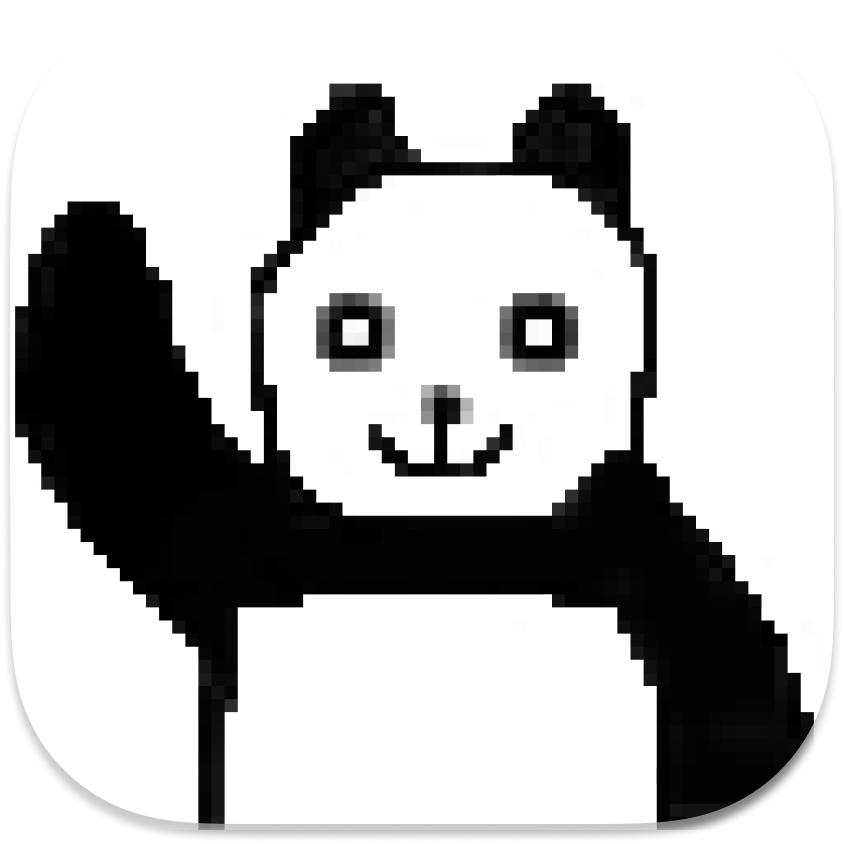
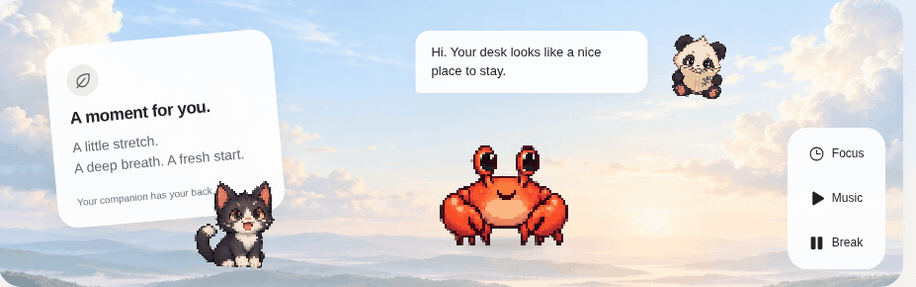

<p align="center">
  
</p>

# Nudge
A gentle desktop companion for a more balanced day at your screen.

📸 Follow the pet: [@the_nudge_app](https://www.instagram.com/the_nudge_app/)

## See it in motion
<p align="center">
  
</p>
A quick loop from the interactive web playground on the <a href="https://nudge-nine-flame.vercel.app/">Nudge site</a> - a browser preview of the same companion engine that runs in the macOS app.

## The problem
It's easy to stay at a computer longer than intended. A timer alone can be easy to ignore, especially when it interrupts at the wrong moment or offers nothing useful to do.

Nudge makes screen time tangible with a desktop companion that gets tired as your active work stretch grows. Its reminders wait for a natural moment, and a break can be a quick eye rest, stretch, breath, or walk.

## Features
- Visual progression: character animation depends on time spent on computer without a break
- Taking a break will restore the character: resting long enough to compensate for time spent without break will recover the companion
- Choose a crab, panda, red panda, tuxedo cat, or capybara, with detailed pixel-art sprites and expressive movement
- Light, Dark, or Match Mac appearance (follows Light and Dark Mode live); resize your pet from 50% to 150% in Settings
- App awareness: waits for a stable category, puts the old activity away, and eases into the next
- Looks toward your pointer, enjoys strokes and clicks, and can be picked up and dragged
- Drop near a window’s top edge to perch there; the pet follows that window without activating it
- Takes short walks to sniff a growing flower, with longer quiet stretches during focused work
- Respects Reduce Motion and pauses wandering during interaction, reminders, and breaks
- Sits on your desktop rather than floating over it: a soft contact shadow, a fine edge that keeps it distinct on bright pages and a faint rim in Dark Mode, a warmer, dimmer tone in the evening, and a little squash when you put it down
- Context-aware phrases: says phrases based on what you're doing (coding, gaming, social, etc.) and how tired the companion is
- Configurable reminder rhythm, ten-minute snooze, automatic-break threshold, screen position, monitor, and per-app categories
- Refreshes installed apps on every launch and when Settings opens, removes deleted apps, and preserves custom categories for apps you still have
- Nudges wait for a pause in typing, the gap between two apps, or your return; they hold for calls and give videos time to end
- Unanswered nudges fold away and your pet dozes off instead of nagging; pet it to wake it
- Optional tab and document awareness in any browser, with your own rules; titles are never saved
- Locking your Mac counts as a break, full-screen video hides the pet, and it can sit on the window you're using
- Focus sessions: your pet holds your intention on a sign, notices drift, and parks stray thoughts
- A garden that grows with every pause (14 plants, some seasonal) and never wilts; save it as a postcard
- A friendship that deepens with care, never screen time, and ten outfits to find
- Fourteen step-by-step resets your pet does with you, suggested for the moment; every pause can be ended early
- Optional wind-down, active hours, and eye, posture and water rhythms
- Wrap up the day with a mood and one thing for tomorrow; read a weekly letter written on your Mac
- Activity summary: time per category and hour, breaks, focus, nudges taken, week-over-week change, 7 days to a year of history
- Private apps, history limits, and one-click erase
- Launch at login and a customizable global shortcut for hiding the companion
- Personal reminder notes that your companion can say at the next reminder
- A small hover status shows the current stretch and what the next reminder is waiting for
- Menu-bar item: companion, breaks, focus, garden, quiet time, summary, Settings and quit, with an optional countdown
- Export your full activity history as a CSV (one row per day, a column per category) from the Activity panel; the file goes to Downloads

## Challenges
- Overlay window that stays out of the way: ignoring mouse events until you hover or click on character
- Mac-specific apis (focused app detection, idle-input monitoring, cursor tracking) not implemented on windows (cuz i only got a mac)
- Break awareness: watching for keyboard/mouse activity to end break early

## The future
- Windows support
- Friend visits

## Installation

Download the macOS installer from [GitHub Releases](https://github.com/B-Eddie/nudge/releases/latest).
The universal DMG supports Apple silicon and Intel Macs. Open it and drag **nudge** into **Applications**.

This community build is not notarized. If macOS blocks it, review the app in **System Settings → Privacy & Security** and use **Open Anyway**.

### Build from source

Requirements: macOS, [Node.js](https://nodejs.org/), [Rust](https://rustup.rs/), and [Tauri prerequisites](https://v2.tauri.app/start/prerequisites/).

```bash
git clone https://github.com/B-Eddie/nudge.git
cd nudge
npm ci

# Run in development
npm run tauri dev

# Build for the current Mac
npm run tauri build

# Build a universal installer
rustup target add aarch64-apple-darwin x86_64-apple-darwin
npm run tauri build -- --target universal-apple-darwin
```

## Companion artwork

The live desktop pet and picker use generated transparent pixel-art sprite sheets in
`src/assets/pets/pixel/`. Each of the five companions has sixteen expressions and poses:
idle, blink, pleased, delighted, curious, lifted, yawning, sleeping, two walking steps,
stretching, grooming, coding, reading, listening to music, and gaming.

Generation used the built-in ImageGen tool; full prompts are recorded in
`src/assets/pets/pixel/PROMPTS.md`. The original atlases stay intact. The renderer
area-averages each isolated pose onto a pixel grid sized so one art pixel covers about two
physical pixels (120×120 for the default size on a Retina display), with stable body
scale and a shared floor. Every output pixel is fully opaque or fully clear, and colour
ignores the sheets' pale anti-aliased fringe, so there's no halo on dark or light windows.
Articulation (head, paws, eyes, props) is calibrated on a 60-unit grid and scaled to the
render grid, so poses line up identically at every resolution. Pose bounds follow the actual connected artwork rather than
fixed grid lines, preventing clipped ears and neighboring-frame fragments. Walking
frames are normalized to one facing direction. App changes still wait for a stable
category and a neutral settling pose.

Blinks and little habits have variable timings. Cats favor grooming; capybaras favor
yawns and curious pauses; tired companions yawn more. Focus work gets longer quiet stretches.
Petting follows a pleased → delighted → settled sequence, and dragging takes priority
over other reactions. Menus, direct attention, and Reduce Motion pause automatic habits.

Previous rendered illustrations and legacy crab art remain available in `src/assets/pets/`
and `src/assets/characters/crab/`; the legacy art retains its original attribution and license.

## Interacting with your companion

Click to pet, move your pointer over it to stroke it, or drag to pick it up.
Right-click or use the small **···** button for breaks, settings, notes, and your summary.
Keyboard users can Tab to the pet and press Space/Enter to pet it, or Shift+F10 to open its actions.
Settings → **Your companion → Character size** previews sizes from 50% to 150%.
Use **Reset** for the original size, then **Save** to apply. Cancel discards the preview.
Position is retained while opening panels; a new launch uses the corner selected in Settings.
Perching uses macOS window bounds only, without screenshots or controlling other apps.
If the window closes or leaves the current Space, the pet stays where it was.


## Data and development
Activity, settings and the companion's memory (garden, outfits, focus sessions) are stored locally in the application's configuration directory.
No account or cloud sync is required.

- Activity writes are atomic and keep the previous valid snapshot as `activity.json.bak`.
  If both files cannot be read, nudge will refuse to overwrite the existing history.
- `companion.json` is stored the same way; an unreadable copy is moved aside and the backup used.
- Tab awareness is off by default and uses macOS Accessibility to read only the front window's
  title and full-screen state. Titles are classified in memory and not written to disk, unless you
  choose one as a focus session. Because builds are ad-hoc signed, macOS may ask again after an update.
- Call awareness reads only whether a microphone or camera is in use and which apps are playing
  sound. Nothing is captured, and no permission is needed. It can be turned off in Settings.
- Settings live in memory and every change is written atomically, so a crash can't leave a
  half-written file and concurrent changes can't undo each other. An unreadable
  `settings.json` is moved aside as `settings.json.corrupt-<timestamp>` rather than replaced.

`npm run check` runs everything CI runs: the TypeScript typecheck, frontend tests,
`rustfmt`, `clippy -D warnings`, and the native tests (the native steps need a Mac with
Rust and the Tauri prerequisites). Pull requests run these checks in CI. The unsigned macOS
release may require a manual Gatekeeper exception; do not disable quarantine
on software you do not trust.

Licensed under MIT; see [LICENSE](LICENSE).
